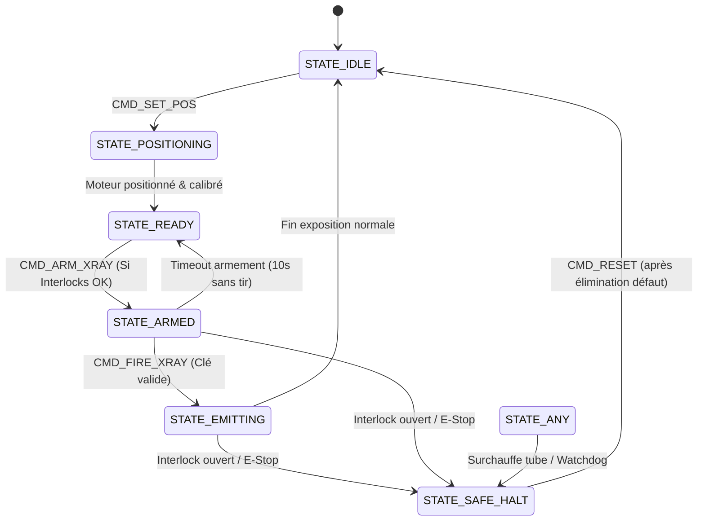

# PRD 01 : Banc de Test Automatisé & Injection de Pannes Firmware
**Nom du projet :** `med-fw-testbench`  
**Classification IEC 62304 :** Outil logiciel de vérification de système médical (Classe B/C)  
**Version :** 1.0.0 | **Statut :** Prêt pour implémentation  

---

## 1. Contexte & Problématique Métier

Dans un équipement de radiologie dentaire (ex. panoramique 2D, Cone Beam CT 3D ou capteur intra-oral), la chaîne de commande d'émission de rayons X et de cinématique (moteurs pas-à-pas de collimation et de rotation du bras) est critique pour la sécurité du patient et du praticien.

Le logiciel applicatif (IHM PC sous Windows / Qt) communique avec des microcontrôleurs embarqués via des protocoles série (UART) ou bus industriels (CAN/Ethernet). Le rôle du testeur système/bas niveau est de prouver de manière irréfutable que :
1. Les séquences d'armement et de tir radiologique respectent strictement la machine à états temps-réel.
2. Tout incident matériel (ouverture d'interlock de porte plombée, arrêt d'urgence, surchauffe tube, blocage moteur) force le système dans un **état de repli sécurisé (Safe State)** en un temps déterministe ($< 50\text{ ms}$).
3. Le firmware est résilient face à des trames corrompues ou des désynchronisations réseau sans plantage ni comportement indéterminé.

---

## 2. Architecture Globale du Banc de Test

```
+-------------------------------------------------------------------------+
|                         HARNESS DE TEST (PyTest)                        |
|                                                                         |
|  +--------------------+  +-----------------------+  +----------------+  |
|  | Scénarios de Test  |  | Moteur d'Injection    |  | Moniteur de    |  |
|  | Nominaux & Limites |  | de Pannes (Bit-flip)  |  | Sécurité & Log |  |
|  +---------+----------+  +-----------+-----------+  +--------+-------+  |
|            |                         |                       |          |
|            +-------------------------+-----------------------+          |
|                                      |                                  |
|                          Client Protocole Binaire                        |
+--------------------------------------|----------------------------------+
                                       | Socket TCP loopback (127.0.0.1:9099)
                                       | ou Pseudo-TTY Serial
+--------------------------------------|----------------------------------+
|                   SIMULATEUR FIRMWARE EMBARQUÉ (AsyncIO)                |
|                                                                         |
|  +--------------------+  +-----------------------+  +----------------+  |
|  | Décodeur / Encodeur|  | Machine à États (FSM) |  | Registre Matériel|
|  | Trame + Vérif CRC8 |  | IDLE -> ARMED -> TIRS |  | Interlocks/Temp|  |
|  +--------------------+  +-----------------------+  +----------------+  |
+-------------------------------------------------------------------------+
```

---

## 3. Spécifications du Protocole de Communication Bas Niveau

### 3.1 Structure de la Trame Binaire

Toutes les communications entre le banc de test et le firmware utilisent un protocole binaire structuré à délimiteurs et contrôle d'intégrité :

| Champ | Taille | Description | Valeurs acceptées |
| :--- | :--- | :--- | :--- |
| `SOF` | 1 octet | Start of Frame | `0x02` (ASCII STX) |
| `MSG_ID` | 1 octet | Identifiant de commande ou réponse | `0x01` à `0xFF` |
| `SEQ_NUM` | 1 octet | Numéro de séquence incrémental | `0x00` à `0xFF` |
| `PAYLOAD_LEN` | 1 octet | Longueur des données utiles | `0` à `32` octets |
| `PAYLOAD` | N octets | Données spécifiques à la commande | Variables |
| `CRC8` | 1 octet | Checksum CRC-8-CCITT ($x^8 + x^2 + x + 1$) | Calculé sur `MSG_ID` + `SEQ_NUM` + `PAYLOAD_LEN` + `PAYLOAD` |
| `EOF` | 1 octet | End of Frame | `0x03` (ASCII ETX) |

### 3.2 Dictionnaire des Commandes

| `MSG_ID` | Mnémonique | Direction | Description | Payload attendu |
| :--- | :--- | :--- | :--- | :--- |
| `0x01` | `CMD_PING` | Test $\rightarrow$ FW | Liveness check | Vide |
| `0x02` | `RSP_PONG` | FW $\rightarrow$ Test | Réponse au ping | `[STATUS_REG:1B]` |
| `0x10` | `CMD_SET_POS` | Test $\rightarrow$ FW | Consigne angle collimateur | `[ANGLE_DEG:uint16_be]` |
| `0x11` | `CMD_ARM_XRAY` | Test $\rightarrow$ FW | Armement générateur RX | `[kV:uint8] [mA:uint8] [TIME_MS:uint16_be]` |
| `0x12` | `CMD_FIRE_XRAY`| Test $\rightarrow$ FW | Ordre de début d'émission | `[CONFIRM_KEY:0xAA55]` |
| `0x13` | `CMD_ABORT` | Test $\rightarrow$ FW | Interruption immédiate | Vide |
| `0x80` | `CMD_INJECT_HW_FAULT` | Test $\rightarrow$ FW | Simulation défaillance capteur | `[FAULT_CODE:1B]` |
| `0xFE` | `EVT_SAFETY_TRIP` | FW $\rightarrow$ Test | Notification asynchrone panne | `[REASON_CODE:1B] [STATE_SNAPSHOT:4B]` |
| `0xFF` | `RSP_NACK` | FW $\rightarrow$ Test | Rejet de commande | `[ERR_CODE:1B]` |

---

## 4. Spécification de la Machine à États (FSM) du Firmware



### Règles Métier Invariants (Safety Invariants) :
1. **INV-01 :** L'émission radiologique (`STATE_EMITTING`) ne peut **jamais** durer plus de `TIME_MS + 20ms` (coupure matérielle redondante du watchdog simulé).
2. **INV-02 :** Si `DOOR_INTERLOCK` passe à `OPEN` pendant `STATE_EMITTING`, l'état passe à `STATE_SAFE_HALT` en moins de $50\text{ ms}$, la ligne de commande générateur est désactivée et un événement `EVT_SAFETY_TRIP` est émis.
3. **INV-03 :** Toute commande `CMD_FIRE_XRAY` reçue dans un état différent de `STATE_ARMED` doit retourner un `RSP_NACK (ERR_ILLEGAL_STATE)` sans modifier l'état.

---

## 5. Exigences Fonctionnelles Détaillées (Harness & Tests)

| ID Exigence | Description | Critère d'Acceptation |
| :--- | :--- | :--- |
| **REQ-TB-01** | **Initialisation & Connexion** | Le harness démarre le simulateur FW en sous-processus et établit la liaison en $<1\text{s}$. |
| **REQ-TB-02** | **Validation Nominale** | Exécution d'un cycle complet d'acquisition (Pos $\rightarrow$ Arm $\rightarrow$ Fire $\rightarrow$ Exposition terminée) avec validation du retour d'état. |
| **REQ-TB-03** | **Injection : Corruption de Trame** | Altération du CRC8 ou troncature d'octet $\rightarrow$ Le FW répond par `RSP_NACK(ERR_BAD_CRC)` ou ignore la trame sans bloquer son écoute. |
| **REQ-TB-04** | **Injection : Violation Séquentielle** | Envoi de `CMD_FIRE_XRAY` sans `CMD_ARM_XRAY` $\rightarrow$ Réponse `ERR_ILLEGAL_STATE`, aucune émission déclenchée. |
| **REQ-TB-05** | **Test de Sécurité Critique (Interlock)** | Déclenchement de `INJECT_HW_FAULT(DOOR_OPEN)` pendant l'émission $\rightarrow$ Notification `EVT_SAFETY_TRIP` reçue en $<50\text{ ms}$, état `STATE_SAFE_HALT`. |
| **REQ-TB-06** | **Test de Récupération (Recovery)** | Envoi de `CMD_RESET` après remise à niveau des sécurités $\rightarrow$ Retour réussi à `STATE_IDLE`. |

---

## 6. Structure du Code & Implémentation Pratique

```
med-fw-testbench/
├── README.md                   # Instructions, architecture et guide d'exécution
├── requirements.txt            # pytest, pytest-timeout, rich
├── firmware_sim/
│   ├── __init__.py
│   ├── protocol.py             # Encodage/Décodage trame, calcul CRC8
│   ├── fsm.py                  # États, transitions, sécurités
│   └── simulator_server.py     # Serveur TCP simulant le microcontrôleur
├── harness/
│   ├── __init__.py
│   ├── client.py               # API cliente pour envoyer des commandes
│   └── fault_injector.py       # Méthodes pour corrompre CRC, tronquer, injecter HW
└── tests/
    ├── conftest.py             # Fixture PyTest démarrant le simulateur
    ├── test_nominal_flow.py    # Cas passants
    ├── test_protocol_faults.py # Tests de trames corrompues et timeouts
    └── test_safety_critical.py # Interlocks, arrêts d'urgence, limites thermiques
```

---

## 7. Critères d'Acceptation & Livrables de Qualification

1. **Suite PyTest 100% verte :** Au minimum 8 cas de test automatisés (nominaux, limites, pannes matérielles).
2. **Rapport d'exécution lisible :** Sortie console riche détaillant chaque transition d'état et injection de panne.
3. **Traçabilité technique :** Code modulaire, architecture de test déterministe et reproductible en intégration continue.
