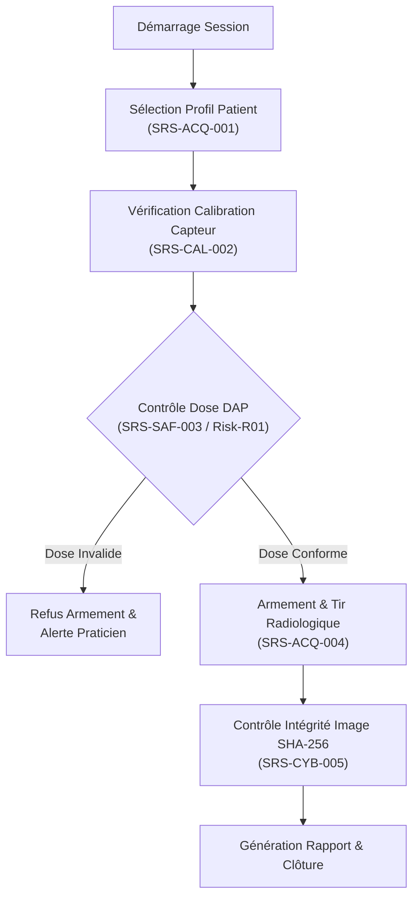

# PRD 02 : Dossier de Vérification Médicale IEC 62304 & Suite BDD
**Nom du projet :** `med-iec62304-traceability-bdd`  
**Normes de référence :** IEC 62304:2006+A1:2015, ISO 14971:2019, ISO 13485:2016  
**Classification logiciel :** Classe B (Dispositif médical - Prévention des blessures non graves/graves)  
**Version :** 1.0.0 | **Statut :** Prêt pour implémentation  

---

## 1. Contexte & Problématique Métier

Dans l'industrie des dispositifs médicaux, le développement agile doit impérativement cohabiter avec les exigences strictes des organismes notifiés (TÜV, FDA, ANSM).

La norme **IEC 62304** impose :
* La traçabilité stricte : $\text{Besoin Utilisateur} \rightarrow \text{Exigence Logicielle (SRS)} \rightarrow \text{Atténuation de Risque (ISO 14971)} \rightarrow \text{Procédure de Test} \rightarrow \text{Rapport d'Exécution}$.
* La preuve que chaque mesure de réduction de risque est testée et validée.
* La formalisation d'un **Plan de Vérification (Test Plan)** et d'un **Rapport de Synthèse (Test Summary Report - TSR)** avant toute release (*Gate Review*).

L'approche BDD (**Behavior-Driven Development**) en langage Gherkin (`Given/When/Then`) permet d'écrire des scénarios lisibles par les cliniciens/ingénieurs qualité tout en étant directement exécutables par le moteur de test automatisé.

---

## 2. Périmètre du Workflow Clinique Testé

Le projet implémente et valide le workflow complet : **"Acquisition d’un Cliché Panoramique Dentaire 2D avec Contrôle de Dose et Calibration Capteur"**.



---

## 3. Spécification des Exigences Logicielles (SRS) & Analyse de Risques (ISO 14971)

### 3.1 Tableau des Exigences & Risques Associés

| ID Exigence | Titre Exigence | Description Fonctionnelle | ID Risque (ISO 14971) | Gravité Initiale | Mesure de Maîtrise |
| :--- | :--- | :--- | :--- | :--- | :--- |
| **SRS-ACQ-001** | Sélection Patient Obligatoire | L'application doit bloquer l'accès à la commande d'armement tant qu'un profil patient (Adulte/Pédiatrique) n'est pas sélectionné. | `RSK-MIS-01` (Erreur de dossier patient) | Moyenne | Verrouillage IHM |
| **SRS-CAL-002** | Validation Calibration Capteur | Le système doit vérifier que la dernière calibration de bruit de fond (Dark Current) date de moins de 24h. | `RSK-IMG-02` (Artefact image menant à mauvais diagnostic) | Élevée | Contrôle automatique au boot |
| **SRS-SAF-003** | Plafond de Dose Pédiatrique | Pour un profil "Enfant", la dose surfacique (DAP) calculée ne doit jamais dépasser $80\text{ mGy}\cdot\text{cm}^2$. | `RSK-RAD-03` (Sur-exposition radiologique du patient) | Critique | Blocage logiciel strict de la consigne kV/mA |
| **SRS-ACQ-004** | Confirmation Double Commande | L'ordre d'armement nécessite un appui continu (> 500 ms) sur le bouton de commande. | `RSK-RAD-04` (Tir intempestif) | Élevée | Temporisation matérielle/logicielle |
| **SRS-CYB-005** | Intégrité du Cliché Brut | Tout fichier d'image brute stocké doit être accompagné d'un condensat SHA-256 calculé avant transfert. | `RSK-SEC-05` (Altération ou falsification des données de santé) | Élevée | Hash cryptographique |

---

## 4. Spécification des Scénarios BDD (Gherkin)

Les scénarios sont rédigés dans des fichiers `.feature` balisés pour la traçabilité automatique.

### Fichier : `features/panoramic_acquisition.feature`
```gherkin
@Component:Acquisition @IEC62304:ClassB
Feature: Vérification du workflow d'acquisition panoramique 2D

  Background:
    Given le système d'imagerie est sous tension et en état "IDLE"
    And la communication avec le capteur numérique est établie

  @SRS-ACQ-001 @Risk-RSK-MIS-01
  Scenario: Refus d'armement si aucun dossier patient n'est actif
    Given aucun profil patient n'est sélectionné
    When le praticien demande l'armement pour un cliché panoramique
    Then le système refuse l'armement avec le message d'erreur "ERR_NO_PATIENT"
    And l'état du système reste "IDLE"

  @SRS-SAF-003 @Risk-RSK-RAD-03 @SafetyCritical
  Scenario Outline: Contrôle du seuil de dose maximale selon la morphologie patient
    Given un patient sélectionné avec la catégorie "<categorie>"
    And les paramètres d'exposition sont réglés à "<kv>" kV et "<ma>" mA
    When le système calcule le produit dose-surface estimé
    Then le statut d'autorisation de tir doit être "<statut>"
    And la dose calculée ne doit pas excéder "<dose_max>" mGy.cm2

    Examples:
      | categorie | kv | ma | statut  | dose_max |
      | Adulte    | 75 | 10 | AUTORISÉ| 250      |
      | Enfant    | 60 | 4  | AUTORISÉ| 80       |
      | Enfant    | 85 | 12 | REFUSÉ  | 80       |

  @SRS-CAL-002 @Risk-RSK-IMG-02
  Scenario: Détection de calibration capteur expirée
    Given la dernière calibration du capteur date de "36" heures
    When le praticien initialise une séquence d'acquisition
    Then le système exige une calibration rapide préalable
    And le déclenchement du générateur reste verrouillé
```

---

## 5. Moteur de Traçabilité & Matrice RTM Automatisée

Le projet intègre un utilitaire Python (`generate_rtm.py`) qui :
1. Analyse les fichiers `.feature` et extrait les tags d'exigences (`@SRS-xxx`) et de risques (`@Risk-xxx`).
2. Exécute la suite de tests `pytest --junitxml=report.xml`.
3. Corrèle chaque exigence avec son scénario et son statut d'exécution (`PASSED`/`FAILED`).
4. Produit la **Matrice de Traçabilité des Exigences (RTM)** au format Markdown et HTML.

### Format de la Matrice Générée :
```
| SRS ID      | Risque ISO 14971 | Scénario Gherkin                             | Statut | Couverture |
|-------------|------------------|----------------------------------------------|--------|------------|
| SRS-ACQ-001 | RSK-MIS-01       | Refus d'armement si aucun dossier patient... | PASS   | 100%       |
| SRS-SAF-003 | RSK-RAD-03       | Contrôle du seuil de dose maximale...        | PASS   | 100%       |
| SRS-CAL-002 | RSK-IMG-02       | Détection de calibration capteur expirée...  | PASS   | 100%       |
```

---

## 6. Structure du Projet

```
med-iec62304-traceability-bdd/
├── README.md                           # Guide d'exécution et justification réglementaire
├── requirements.txt                    # pytest, pytest-bdd, jinja2
├── docs/
│   ├── SRS.md                          # Spécification des exigences logicielles
│   ├── Risk_Analysis_ISO14971.md       # Analyse de risques (FMEA)
│   ├── Test_Plan.md                    # Plan de vérification logicielle (SVP)
│   └── Test_Summary_Report_Template.md # Modèle de TSR pour audit
├── features/
│   └── panoramic_acquisition.feature   # Scénarios Gherkin taggés
├── step_defs/
│   ├── __init__.py
│   ├── conftest.py                     # Modèle applicatif simulé
│   └── test_panoramic_steps.py         # Implémentation des steps Python
└── tools/
    └── generate_rtm.py                 # Générateur automatique de la matrice RTM
```

---

## 7. Critères d'Acceptation & Livrables de Qualification

1. **Suite BDD exécutable :** Lancement via `pytest` avec exécution fluide des scénarios nominaux et d'échec.
2. **Matrice RTM "Audit-Ready" :** Fichier généré démontrant zéro exigence orpheline.
3. **Test Summary Report (TSR) complété :** Synthèse formelle prête pour une revue de jalon (*Gate Review*).
